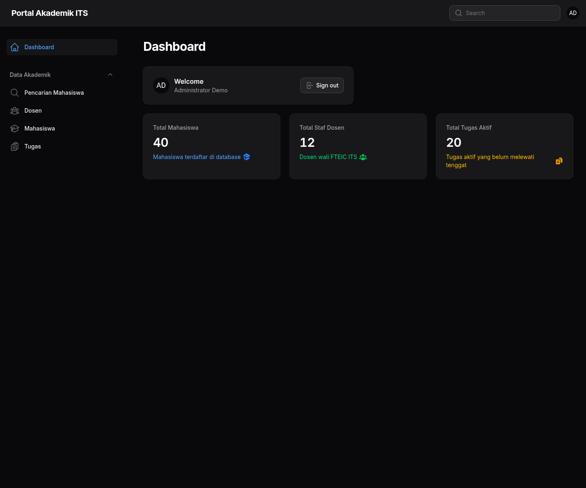
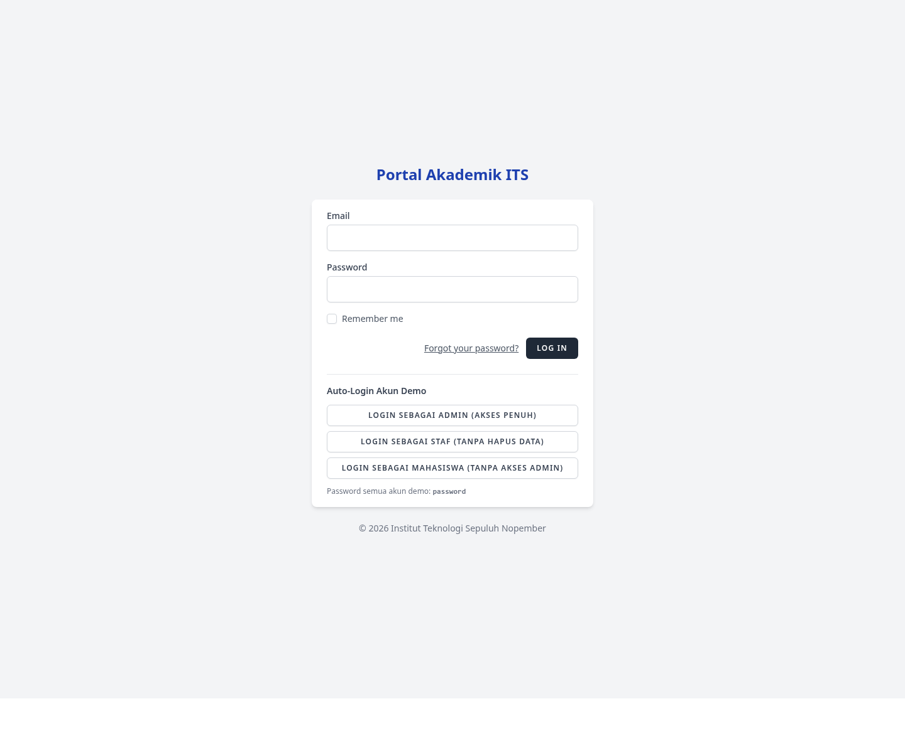
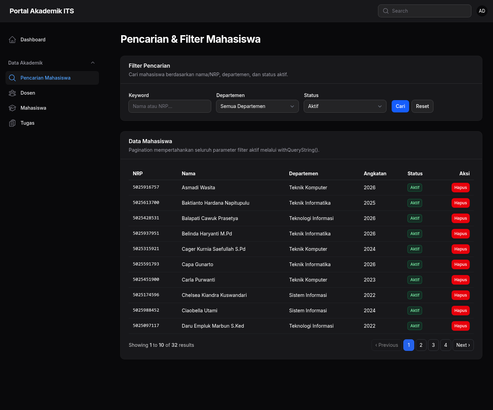
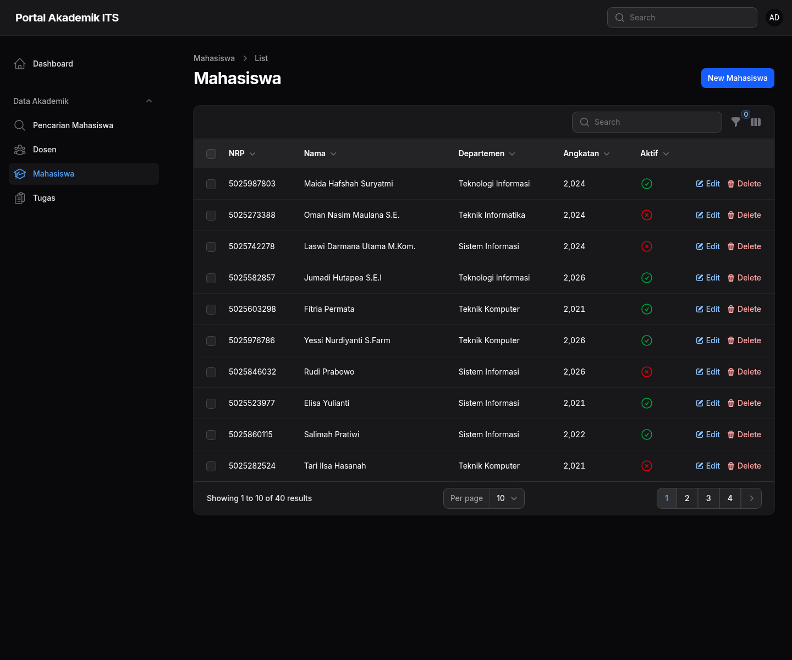
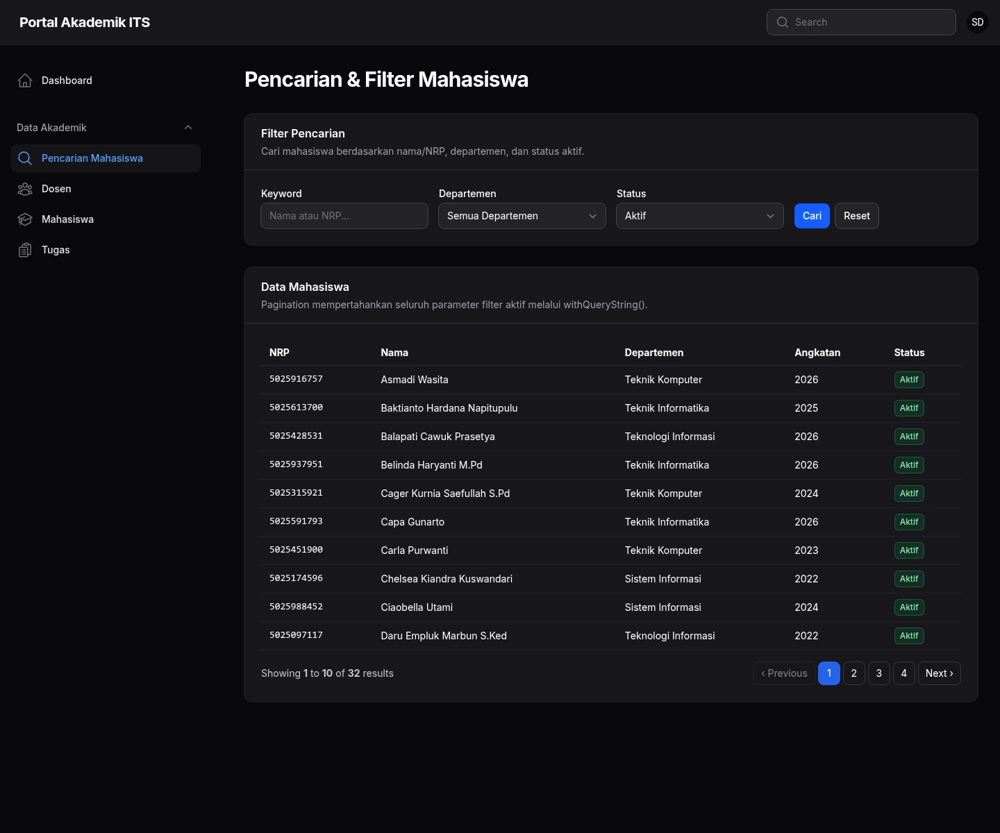
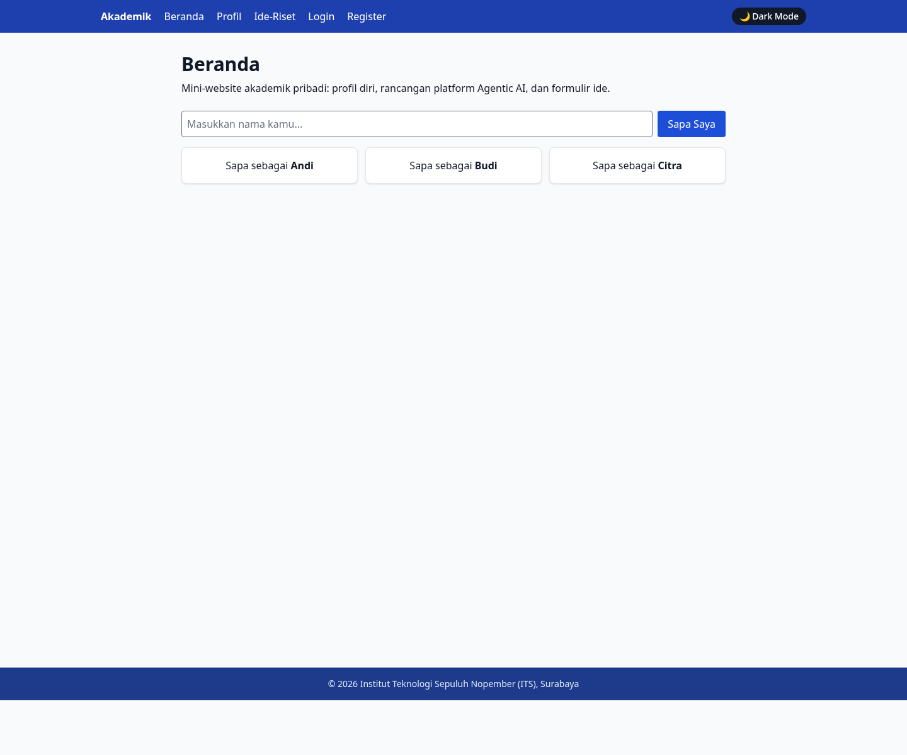

# Tugas W10 PBKK - Portal Akademik ITS

Aplikasi Laravel 13 untuk Tugas Mandiri Pertemuan 10: **Admin Dashboard & Role-Based Access Control**.

Fitur utama:

- Public academic mini-site (beranda, profil mahasiswa, ide riset Agentic AI)
- Admin panel berbasis **Filament v5** pada `/admin`
- Autentikasi **Laravel Breeze** sebagai satu-satunya halaman login
- Otorisasi dinamis **Spatie Laravel Permission** dengan role `Admin` dan `Staf`
- Widget statistik dashboard dari kueri `count()` model
- Pencarian/filter memakai `when()` dan pagination `withQueryString()`
- Faker seeder untuk data mahasiswa, dosen, dan tugas
- Tombol auto-login akun demo (hanya aktif di environment `local`/`testing`)

## Prerequisites

Pastikan terpasang:

- PHP 8.3 atau lebih baru
- Composer
- Node.js 20.19+ atau 22.12+
- NPM
- Ekstensi PHP **`intl`** (wajib untuk Filament)

Cek versi:

```bash
php -v
composer -V
node -v
npm -v
php -m | grep intl
```

Jika `intl` belum ada (Fedora/RHEL):

```bash
sudo dnf install php-intl
```

Untuk distro lain, install paket `php-intl` / `php8.x-intl` sesuai sistem.

## Installation

### 1. Install dependency PHP

```bash
composer install
```

### 2. Install dependency JavaScript

```bash
npm install
```

### 3. Siapkan environment

```bash
cp .env.example .env
php artisan key:generate
```

Pastikan `DB_CONNECTION=sqlite` di `.env`, lalu buat file database jika belum ada:

```bash
touch database/database.sqlite
```

### 4. Jalankan migrasi dan seeder

```bash
php artisan migrate
php artisan db:seed
php artisan filament:assets
```

> **Catatan:** jangan gunakan `migrate:fresh` jika database sudah berisi data.
> Seeder pada proyek ini bersifat idempotent dan tidak menghapus data lama.
> Data dummy hanya dibuat jika tabel terkait masih kosong.

### 5. Build asset frontend

```bash
npm run build
```

atau untuk development:

```bash
npm run dev
```

## Running the Application

Jalankan Laravel:

```bash
php artisan serve
```

Buka:

```text
http://127.0.0.1:8000
```

Admin panel:

```text
http://127.0.0.1:8000/admin
```

Login:

```text
http://127.0.0.1:8000/login
```

## Demo Accounts

Semua akun demo memakai password: **`password`**

| Role | Email | Akses |
|---|---|---|
| Admin | `admin@demo.test` | Akses penuh, termasuk hapus data |
| Staf | `staf@demo.test` | Dashboard + CRUD, tanpa hapus data |
| Mahasiswa | `mahasiswa@demo.test` | Tidak bisa masuk panel admin |

Pada halaman login juga tersedia tombol **Auto-Login Akun Demo** saat `APP_ENV=local`.
Tombol tersebut otomatis nonaktif di production.

## Role & Permission Matrix

| Permission | Admin | Staf |
|---|---:|---:|
| `view-dashboard` | ✅ | ✅ |
| `manage-mahasiswa` | ✅ | ✅ |
| `manage-dosen` | ✅ | ✅ |
| `manage-tugas` | ✅ | ✅ |
| `hapus-data` | ✅ | ❌ |

Pengamanan dilakukan berlapis:

1. Route group Filament memakai middleware `auth` + `role:Admin|Staf`.
2. Policy model menolak `delete`/`deleteAny` jika user tidak punya `hapus-data`.
3. Tombol hapus di Blade dibungkus `@can('hapus-data')`.
4. Route hapus memakai middleware `permission:hapus-data`.
5. Controller memanggil `$this->authorize('delete', $mahasiswa)`.

## Fitur Tugas Mandiri

- [x] UI backoffice memakai Filament v5
- [x] Autentikasi via Laravel Breeze
- [x] Role/permission tersimpan di database melalui Spatie
- [x] 3 widget statistik dinamis di dashboard
- [x] Proteksi controller dan route dari bypass URL
- [x] Role `Admin` dan `Staf` dengan hak berbeda
- [x] Hapus data eksklusif untuk `Admin`

## Tantangan Tambahan

- [x] Pencarian multi-kolom (`nama` / `nrp`) memakai `when()`
- [x] Filter departemen dan status aktif
- [x] Pagination mempertahankan query string dengan `withQueryString()`
- [x] Seeder Faker `id_ID` untuk puluhan data realistis
- [x] Auto-login akun uji coba di halaman login (local only)

## Screenshots

| Halaman | Screenshot |
|---|---|
| Dashboard Admin |  |
| Login + Auto-Login Demo |  |
| Pencarian & Filter (Admin) |  |
| CRUD Mahasiswa |  |
| Tampilan Staf (tanpa tombol hapus) |  |
| Public Home |  |

## Testing

```bash
php artisan test
vendor/bin/pint --dirty
```

Test menggunakan database SQLite in-memory (`phpunit.xml`), sehingga tidak menyentuh
`database/database.sqlite` milik aplikasi.

## Project Structure

```text
app/
  Filament/
    Pages/PencarianMahasiswa.php
    Resources/Dosens/
    Resources/Mahasiswas/
    Resources/Tugas/
    Widgets/StatOverview.php
  Http/Controllers/
    Admin/MahasiswaController.php
    Auth/DemoLoginController.php
  Models/Mahasiswa.php
  Models/Dosen.php
  Models/Tugas.php
  Policies/
  Providers/Filament/AdminPanelProvider.php
database/
  factories/
  seeders/
resources/views/filament/pages/pencarian-mahasiswa.blade.php
docs/screenshots/
```

## Security Notes

- `.env`, `vendor/`, dan file SQLite tidak boleh di-commit.
- Auto-login demo hanya aktif di `local`/`testing`.
- Aksi hapus selalu divalidasi ulang di server, bukan hanya disembunyikan di UI.
- Semua input pencarian memakai query builder sehingga aman dari SQL injection.

## License

MIT
